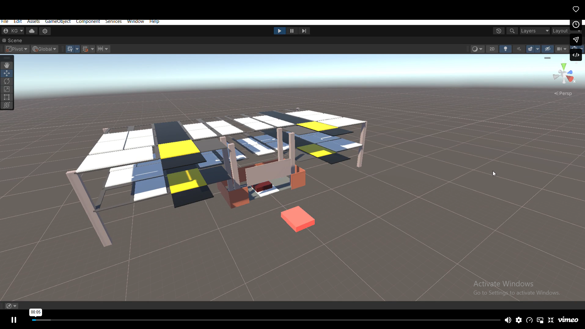
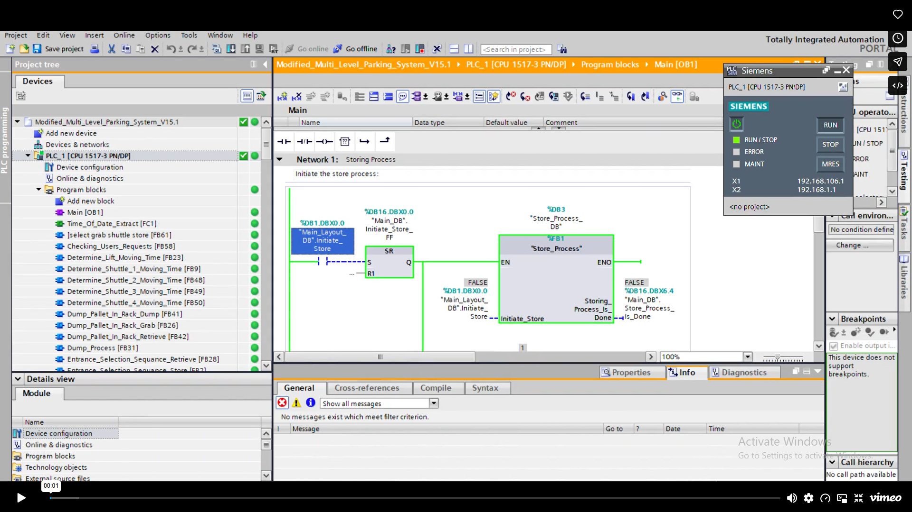

# Autonomous Parking System Digital Twin

### Bringing industrial control logic to life in Unity.

A real-time digital twin of an autonomous parking system, built with **Unity** and integrated with **Siemens TIA Portal**. The project connects a 3D smart parking environment with PLC control logic to demonstrate how industrial automation and interactive simulation can work together.

## About the project

The simulation replicates an automated parking environment, with Unity visualizing vehicle movement and system behavior in sync with logic programmed for Siemens PLCs. It makes the relationship between control decisions and their effects visible in a real-time 3D environment.

Designed to demonstrate **Industry 4.0** concepts, the project brings together cyber-physical integration, real-time feedback, and sensor–actuator modeling within a parking-system simulation.

## Highlights

- **Real-time 3D visualization:** A Unity environment that displays the parking system's movement and behavior.
- **PLC integration:** Simulation behavior synchronized with Siemens PLC logic developed in TIA Portal.
- **Automated parking environment:** A digital representation of a multi-level parking system.
- **Sensor–actuator modeling:** Simulated inputs and outputs connect control logic to behavior in the virtual environment.
- **Real-time feedback:** System state and control decisions are reflected in the simulation.
- **Industry 4.0 demonstration:** An example of integrating industrial automation with a digital representation of a physical process.

## Technologies

| Technology | Purpose |
| --- | --- |
| Unity | 3D parking environment and real-time visualization |
| Siemens TIA Portal | PLC programming and control logic |
| Siemens PLC simulation | Execution and observation of the control behavior |

## How it works

1. The parking environment models the system's state and sensor inputs.
2. PLC logic processes those inputs and determines the corresponding control actions.
3. Unity visualizes the resulting movement and system behavior, with feedback keeping the simulation synchronized with the control logic.

## Screenshots

### Unity parking simulation

The 3D parking environment, showing multiple parking levels and the central handling structure.

### TIA Portal control logic

The parking system's storing-process logic in TIA Portal, with the Siemens PLC simulation running.

## Repository purpose

This repository is a public portfolio showcase of the Autonomous Parking System Digital Twin. It contains a project overview and screenshots; source code, PLC project files, and executable builds are not included.

---

A project by [Kabbashi Gasim](https://github.com/kabashi1999).
